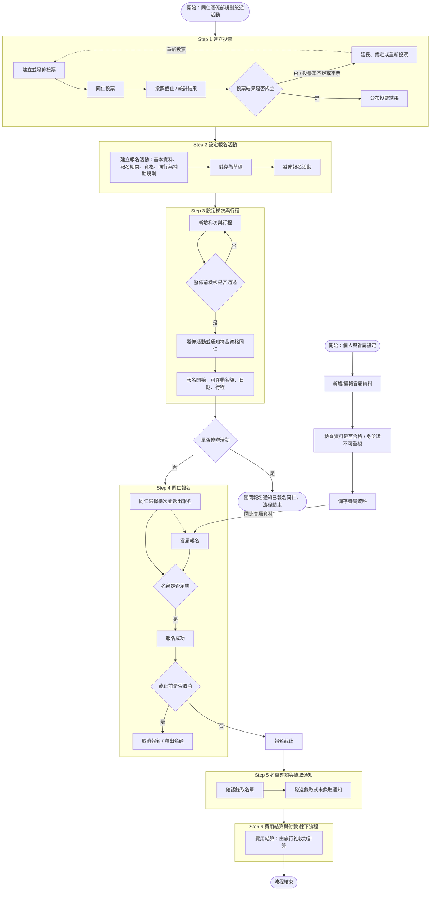

# 旅遊平台系統操作主流程（draw.io 轉錄）

## 來源

- 檔名：`旅遊平台流程_overview.drawio`
- Google Drive file id：`1kQ1_rvndgnemqOJYzCYB2Mv5YyRSgqEA`
- 擁有者：ann.chen；最後修改：2026-10-14
- 入口：ClickUp PRD「旅遊平台重購 PRD」首頁的「系統操作主流程」連結
- 轉錄日期：2026-11-04

轉錄說明：

- 檔案只有 1 個分頁（`第 1 页`），共 80 個 mxCell。
- 以 mxCell 的文字、連線的 source／target 和外框區塊重建流程。下文的節點文字、連線標籤和備註都照抄原文。
- 標「（推論）」的內容是轉錄時的判斷，圖中沒有明寫。
- 這張圖是先用 mermaid 產生，再用 draw.io 手動修改。節點保留了 mermaid 原始文字（`mermaidBaseValue`），有些跟現在顯示的文字不同；有參考價值的差異列在[待釐清](#待釐清)。

## 分頁「第 1 页」

### 角色與區塊

圖中沒有泳道，流程用 6 個彩色外框（Step 1–6）分段。角色只出現在節點和備註文字中：

| 角色／系統 | 出現位置 |
| --- | --- |
| 同仁關係部 | 起點「開始：同仁關係部規劃旅遊活動」；備註「同步hr 資料」「停辦不取消」 |
| 同仁 | 「同仁投票」「同仁選擇梯次並送出報名」「發佈活動並通知符合資格同仁」 |
| 眷屬 | 「眷屬報名」、起點「開始：個人與眷屬設定」 |
| 管理員 | 只出現在備註「MOT事件」，是成團人數不足時的通知對象之一 |
| 旅行社 | 「費用結算：由旅行社收款計算」 |
| 飛騰 | 備註「同步hr 資料」，現行會到這裡下載同仁資料 |
| 饗賓人 | 備註「MOT事件」，用來發推播 |

除了以上節點，其他步驟沒有標示由誰執行。推論：Step 1–3、Step 5 的建立、發佈、確認等後台操作由同仁關係部執行。

| 區塊 | 標題（原文） | 區塊內節點 |
| --- | --- | --- |
| Step 1 | 建立投票 | 建立並發佈投票 → 同仁投票 → 投票截止／統計結果 → 投票結果是否成立 → 公布投票結果；延長、裁定或重新投票 |
| Step 2 | 設定報名活動 | 建立報名活動 → 儲存為草稿 → 發佈報名活動 |
| Step 3 | 設定梯次與行程 | 新增梯次與行程 → 發佈前檢核是否通過 → 發佈活動並通知符合資格同仁 → 報名開始，可異動名額、日期、行程 |
| Step 4 | 同仁報名 | 同仁選擇梯次並送出報名、眷屬報名、名額是否足夠、報名成功、截止前是否取消、取消報名／釋出名額 |
| Step 5 | 名單確認與錄取通知 | 確認錄取名單 → 發送錄取或未錄取通知 |
| Step 6 | 費用結算與付款（線下流程） | 費用結算：由旅行社收款計算 |

以下節點不在任何 Step 區塊內：「開始：同仁關係部規劃旅遊活動」「是否停辦活動」「關閉報名通知已報名同仁，流程結束」「報名截止」「流程結束」，以及「個人與眷屬設定」這組子流程。

Step 1→2、2→3、5→6 的連線是從整個區塊連到下一個區塊，不是從區塊內最後一個節點連出。

### 流程步驟

**起點**

0. 開始：同仁關係部規劃旅遊活動 → 進入 Step 1。

**Step 1 建立投票**

1. 建立並發佈投票。
2. 同仁投票。
3. 投票截止 / 統計結果。
4. 判斷「投票結果是否成立」：
   - 是 → 第 5 步。
   - 否（連線標籤：「否 / 投票率不足或平票」）→「延長、裁定或重新投票」。這個節點只有一條虛線（標籤「重新投票」）回到第 1 步，延長和裁定之後怎麼走沒有畫。
5. 公布投票結果。這個節點本身沒有往下的連線，接著由 Step 1 整個區塊連到 Step 2。

**Step 2 設定報名活動**

6. 建立報名活動：基本資料、報名期間、資格、同行與補助規則。
7. 儲存為草稿。
8. 發佈報名活動。這個節點本身沒有往下的連線，接著由 Step 2 整個區塊連到 Step 3。

Step 2 正下方的備註（依位置推論屬於這一段），標題為紅字：

> **同步hr 資料 若有離職/留停者的特殊處理**
> 於首頁或特定頁面做同仁在職狀況的異常警示，讓同仁關係部可以後續處理。現行狀況是定期到飛騰做同仁資料下載手動比對。

**Step 3 設定梯次與行程**

9. 新增梯次與行程。
10. 判斷「發佈前檢核是否通過」：
    - 否 → 回到第 9 步。
    - 是 → 第 11 步。
11. 發佈活動並通知符合資格同仁。
12. 報名開始，可異動名額、日期、行程。
13. 判斷「是否停辦活動」（位於 Step 3 區塊外下方）：
    - 是 →「關閉報名通知已報名同仁，流程結束」（終點）。
    - 否 → 進入 Step 4（連線指向整個 Step 4 區塊）。

Step 3 右側的備註（位置靠近第 11、12 步）：

> **MOT事件**
> - 原有報名成功、取消 都會收到 mail 通知。
> - 要加上成功、取消、繳費開始提醒、催繳 (前24小時)。
> - 要新增繳費期限設定，繳費期限開始(d-1)、截止日 (d-1)，MOT 事件，用饗賓人推播、mail 通知。
> - 報名截止前2小時，若最低成團人數不足時，通知推播及mail，管理員與報名的同仁(只要通知同仁，眷屬不用)。

「是否停辦活動」右側的備註：

> **停辦不取消**
> 如今年的小豆島忽然得知，航空公司的班機有改，因此另外開團請小豆島的同仁換行程及梯次。故不能取消，但可以另開活動。
> 同仁關係部需要兩邊名單做比對，手動匯出。

**個人與眷屬設定（另一個起點，位於 Step 4 左側、區塊外）**

- P1. 開始：個人與眷屬設定。
- P2. 新增/編輯眷屬資料。
- P3. 檢查資料是否合格／身份證不可重複。這是一般步驟框，不是判斷菱形，所以沒有不合格時的分支。
- P4. 儲存眷屬資料 → 連到 Step 4 的「眷屬報名」，連線標籤為「同步眷屬資料」。

P2 左側的備註：

> **眷屬上限**
> 與報名活動設定同步，如活動上限是4位，這邊的設定最多也只能4位。

**Step 4 同仁報名**

14. 同仁選擇梯次並送出報名。這一步有兩條連出：
    - 實線 → 第 15 步。
    - 虛線 →「眷屬報名」→ 第 15 步。眷屬報名同時接收 P4 的「同步眷屬資料」。
15. 判斷「名額是否足夠」：
    - 是 → 第 16 步。
    - 否：圖中沒有畫。
16. 報名成功。
17. 判斷「截止前是否取消」：
    - 是 →「取消報名／釋出名額」。之後沒有連線。
    - 否 →「報名截止」（位於 Step 4 與 Step 5 之間）→ 進入 Step 5。

Step 4 右側的備註（位置靠近第 14、15 步）：

> **停留時間超過 300秒 踢出**
> (秒數待議)
> 若資料未寫完送出，就踢出重新報名。

**Step 5 名單確認與錄取通知**

18. 確認錄取名單。
19. 發送錄取或未錄取通知。這個節點本身沒有往下的連線，接著由 Step 5 整個區塊連到 Step 6。

**Step 6 費用結算與付款（線下流程）**

20. 費用結算：由旅行社收款計算。
21. 流程結束。

### 流程圖

只放流程節點，不放備註。區塊之間的連線照原圖畫成區塊到區塊。

## 與 phase 1／phase 2 功能的對應

PRD 分期：phase 1 是首頁、權限管理、投票設定；phase 2 是我的資料與行程、報名管理、公告條款與通知管理。

| 圖中步驟或備註 | 對應 PRD 功能 | 期別 | 依據 |
| --- | --- | --- | --- |
| Step 1：建立並發佈投票、投票截止／統計結果、投票結果是否成立、延長／裁定／重新投票、公布投票結果 | 投票設定 › 投票活動設定 | phase 1 | 名稱直接對應 |
| Step 1：同仁投票 | 投票設定 › 員工投票頁 | phase 1 | 名稱直接對應 |
| 備註「同步hr 資料…於首頁或特定頁面做同仁在職狀況的異常警示」 | 首頁 | phase 1 | 原文寫「首頁或特定頁面」，還沒定案（推論） |
| 起點「同仁關係部規劃旅遊活動」，以及 MOT 備註中的「管理員」 | 權限管理（角色管理、帳號管理、操作紀錄） | phase 1 | 圖中沒有權限管理的步驟。推論後台操作者（同仁關係部、管理員）的身分由權限管理控制 |
| Step 2：建立報名活動（基本資料、報名期間、資格、同行與補助規則）、儲存為草稿、發佈報名活動 | 報名管理 › 報名活動設定（含眷屬限制） | phase 2 | 「同行」對應眷屬限制（推論） |
| Step 3：新增梯次與行程、發佈前檢核、發佈活動、報名開始可異動 | 報名管理 › 報名行程與梯次 | phase 2 | 名稱直接對應 |
| 是否停辦活動、關閉報名通知已報名同仁 | 報名管理（推論為報名活動設定）＋通知 | phase 2 | 推論 |
| 個人與眷屬設定（P1–P4）、備註「眷屬上限」 | 我的資料與行程 › 個人與眷屬資料 | phase 2 | 名稱直接對應；眷屬上限連動報名活動設定 |
| Step 4：同仁選擇梯次並送出報名、眷屬報名、名額是否足夠、報名成功 | 我的資料與行程 › 我要報名 | phase 2 | 名稱直接對應 |
| Step 4：截止前是否取消、取消報名／釋出名額 | 我的資料與行程 › 我的行程 | phase 2 | 推論，取消入口可能在我的行程 |
| 備註「停留時間超過 300秒 踢出」 | 我的資料與行程 › 我要報名 | phase 2 | 依位置推論 |
| Step 5：確認錄取名單 | 報名管理 › 報名訂單查詢 | phase 2 | 推論 |
| 發佈活動並通知符合資格同仁、發送錄取或未錄取通知、備註「MOT事件」 | 公告條款與通知管理 | phase 2 | 推論 |
| Step 6：費用結算（線下流程） | 無對應頁面 | — | 圖中標示為線下流程 |

PRD 有、但圖中沒有出現的項目：

- phase 1：投票名單匯入、候選行程、角色管理、帳號管理、操作紀錄、「央廚」版。
- phase 2：集合／出發地點、表單下載區、報名文件批次下載紀錄、公告條款。

## 待釐清

**連線斷掉或沒有畫出去向**

1. 「名額是否足夠」只有「是」分支，名額不足時怎麼處理沒有畫。檔案中殘留的 mermaid 原始碼有 C1、C2、C3、C5、C6，缺 C4；「取消報名／釋出名額」的原始文字是「釋出名額，候補遞補」。推論原本畫有候補流程，後來刪掉了。需要確認有沒有候補機制。
2. 「取消報名／釋出名額」之後沒有連線。釋出的名額怎麼處理、要不要通知都沒有畫；MOT 備註有提到取消要發 mail 和推播。
3. 「延長、裁定或重新投票」只有「重新投票」一條虛線回到「建立並發佈投票」。延長、裁定之後怎麼走，以及由誰裁定，都沒有畫。「投票率不足」的門檻也沒有定義。
4. 「公布投票結果」「發佈報名活動」「發送錄取或未錄取通知」本身都沒有往下的連線，只靠區塊到區塊的連線銜接。投票結果怎麼帶入報名活動（例如是否決定行程）沒有說明。
5. 「個人與眷屬設定」是另一個起點，跟主流程的先後關係沒有畫，例如是否必須在報名前完成。「同步眷屬資料」這條連線的實際意義也需要確認。
6. 「檢查資料是否合格／身份證不可重複」是一般步驟框，沒有不合格時的分支。「不可重複」的範圍也不清楚：是同一位同仁的眷屬之間不可重複，還是全平台不可重複。

**語意不清**

7. Step 2 有「發佈報名活動」，Step 3 又有「發佈活動並通知符合資格同仁」，兩次發佈的差異需要確認。
8. 「是否停辦活動」接在「報名開始」之後，選「否」就直接進入 Step 4。報名期間是否隨時都能停辦，需要確認。另外，節點寫「關閉報名通知已報名同仁，流程結束」，備註卻寫「停辦不取消…故不能取消，但可以另開活動」「兩邊名單做比對，手動匯出」。這兩者是什麼關係？另開活動時，已報名的同仁怎麼轉過去？
9. 「同仁選擇梯次並送出報名」到「眷屬報名」是虛線，推論代表選填（有帶眷屬才走這條）。眷屬會不會佔名額，需要確認。
10. 報名時已經檢查名額並「報名成功」，報名截止後卻還有「確認錄取名單」「發送錄取或未錄取通知」。錄取依據是什麼（先搶先贏、抽籤或審核）？
11. Step 6 費用結算標示為線下流程，但 MOT 備註要求系統做「繳費期限設定」「繳費開始提醒、催繳」。系統要不要記錄繳費狀態？Step 2 有「補助規則」，Step 6 的原始文字是「費用結算：補助與自費」，現在改成「由旅行社收款計算」。補助要在系統內計算，還是也走線下？
12. 備註「停留時間超過 300秒 踢出」：秒數待議，停留時間從什麼時候開始算也沒說明。踢出時是否會釋放暫時保留的名額？推論可能有暫時保留名額的機制，但圖中沒有畫。
13. 備註「同步hr 資料」：同步頻率、資料來源介接方式都沒說明，異常警示要放在首頁還是其他頁面也還沒定。
14. MOT 備註提到「管理員」，起點寫「同仁關係部」。兩者是不是同一個角色？

**縮寫與名詞**

15. MOT：推論是 Moment of Truth（關鍵接觸時刻），在這裡指會觸發通知的事件。
16. 饗賓人：推論是公司內部的員工 App 或推播管道。
17. 飛騰：推論是現行的 HR 系統。
18. 留停：推論是留職停薪。
19. 「繳費期限開始(d-1)、截止日 (d-1)」：d-1 推論指前一天發提醒，但跟另一點「催繳 (前24小時)」的關係不清楚。
20. 小豆島：備註中舉例的實際行程名稱。

**檔案中殘留的 mermaid 原始文字**

21. 以下差異供判斷各段的定案程度。P1–P4 和「眷屬報名」是複製其他節點做成的，原始文字沒有參考意義，所以不列。

| 目前顯示文字 | mermaid 原始文字 |
| --- | --- |
| Step 5 名單確認與錄取通知 | 圖5 名單確認與錄取通知（待確認） |
| Step 6 費用結算與付款 線下流程 | 圖7 費用結算與結案（待確認） |
| 費用結算：由旅行社收款計算 | 費用結算：補助與自費 |
| 取消報名 / 釋出名額 | 釋出名額，候補遞補 |
| 報名開始，可異動名額、日期、行程 | 報名中，可異動名額、日期、行程 |
| 關閉報名通知已報名同仁，流程結束 | 關閉報名並通知已報名同仁，流程結束 |

- 原始文字把 Step 5、Step 6 標為「（待確認）」，目前顯示的文字已經拿掉這個標記。
- 原始編號從「圖5」跳到「圖7」，缺圖6。
- 「流程結束」的入線在原始碼中來自節點 K2，但圖中只剩 K1（費用結算）。推論原本還有一個結算後的步驟（例如結案）被刪掉了。
