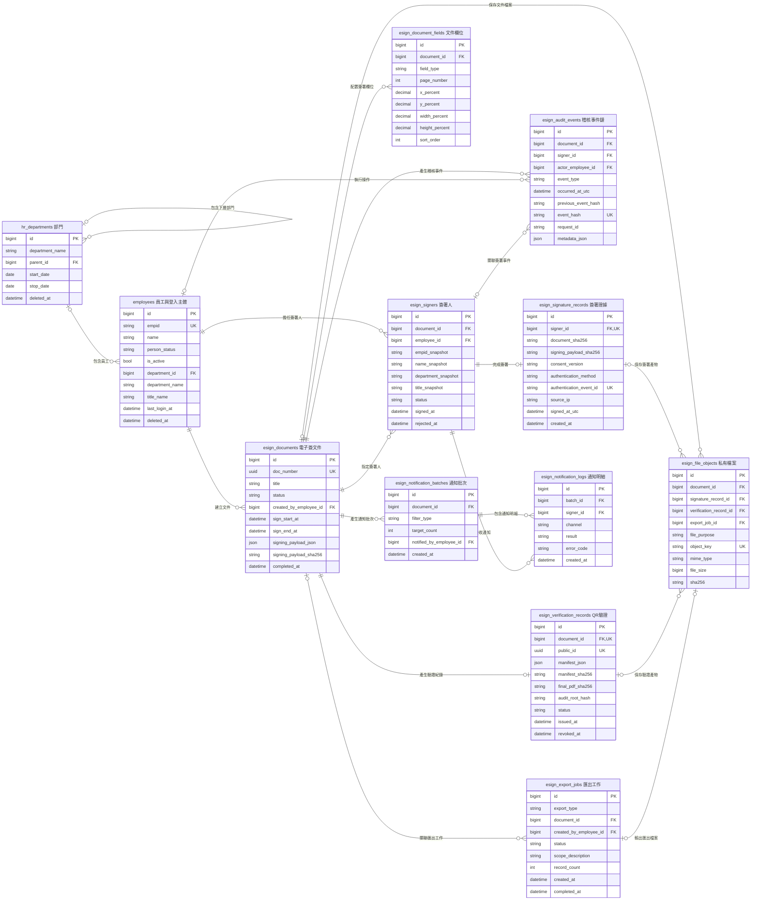

# 內部電子簽章平台 ER Model

> 文件狀態：規劃中
> 範圍：第一階段 12 張 MySQL 資料表
> 說明：登入 session、SSO transaction、nonce、launch code 與重放防護存放於 Redis，不建立 MySQL session table。

圖中為維持可讀性只列主要欄位；完整欄位、可空性、索引與語意以 [internal-electronic-signature-data-dictionary.md](./internal-electronic-signature-data-dictionary.md) 為準。

## 模型邊界

- 文件進入 `in_progress` 後，文件、欄位、簽署人及 `signing_payload_json` 必須鎖定；需要修改時建立新文件。
- `signing_payload_json` 與 `manifest_json` 必須使用固定 canonicalization 規則，再由 server 計算 SHA-256。
- QR Code 只包含 `/verify/{public_id}` 驗證網址，不包含完整 manifest、員工個資或簽名圖檔。
- PDF、簽名圖檔、manifest、QR Code 與匯出檔案存放於 private object storage；MySQL 的 `esign_file_objects` 只保存 object key、hash 及必要 metadata。
- `esign_signature_records`、`esign_audit_events` 與 `esign_verification_records` 屬證據資料，不提供一般管理後台修改或刪除。
- 第一階段不建立 `auth_users`、identity binding、RBAC、provider、session 或 document version 資料表；單一 issuer 驗證完成後直接以員工編號對應 `employees.empid`。
