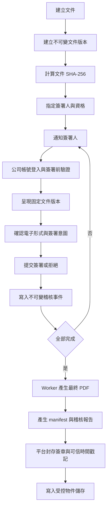
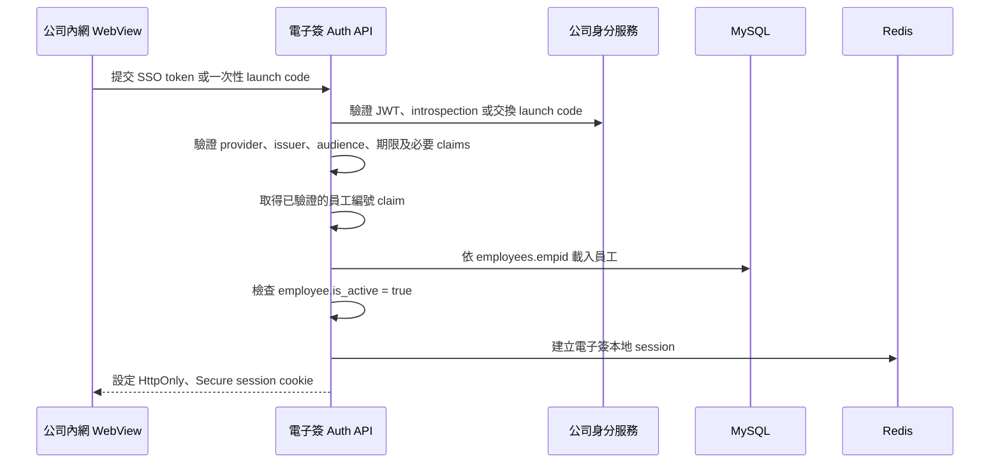

# 公司內部一般電子簽章平台技術設計建議

> 文件狀態：規劃中
> 適用範圍：饗賓內部員工使用的一般電子簽章平台
> 最後更新：2026-10-08

## 1. 目的

本文件定義公司內部一般電子簽章平台的法律定位、技術要求、證據保存方式、安全控制與分階段實作方向，作為後端 API、資料庫、檔案儲存、背景工作及前端簽署流程的共同依據。

本系統預計採用下列方式建立電子簽署證據鏈：

- 公司帳號與員工資料辨識簽署人。
- 簽署前重新驗證或多因素驗證。
- 將簽署行為綁定到特定文件版本及 SHA-256 摘要。
- 保存明確的簽署意圖與電子形式告知紀錄。
- 使用不可任意修改的稽核事件保存完整歷程。
- 封存最終 PDF、稽核紀錄及驗證資訊。
- 視風險使用平台憑證與可信時間戳記強化文件完整性。

本文件是產品及工程設計建議，不構成特定文件或個案的法律意見。勞動契約、個資同意書、薪資、離職或其他法定書面，仍應由法務或主管單位逐類確認適用規範與保存期限。

## 2. 法律與產品定位

### 2.1 目標定位

本系統的第一階段目標是建立符合《電子簽章法》定義、可提出完整證據鏈的「一般電子簽章平台」。

依《電子簽章法》第 2 條，電子簽章應能達成：

1. 簽章依附於電子文件並與文件相關聯。
2. 辨識及確認簽署人的身分與資格。
3. 確認電子文件真偽，並能發現簽署後的內容變更。

法律採技術中立原則，並未要求一般電子簽章一定使用特定廠商、憑證或演算法。但只有手寫簽名圖片、輸入姓名或勾選同意，而沒有身分驗證、文件綁定與防竄改證據，不能作為本系統的完整電子簽章機制。

### 2.2 非目標

第一階段不包含：

- 自行成為憑證機構（CA）。
- 自行簽發具《電子簽章法》第 6 條推定效力的個人數位憑證。
- 宣稱每位員工已使用個人私密金鑰完成數位簽章。
- 宣稱平台封存憑證等同於每位員工親自使用數位憑證簽署。
- 未經逐項法規確認，就假設所有公司文件皆可完全取代紙本。

### 2.3 一般電子簽章與數位簽章的邊界

一般電子簽章的法律效果需依個案證據判斷。本系統應以完整、可驗證的證據鏈證明簽署人、簽署意圖、文件版本及文件完整性。

若未來需要《電子簽章法》第 6 條所定「推定為本人親自簽名或蓋章」的較強效果，應讓每位簽署人使用主管機關許可之憑證機構所簽發、仍在有效期間及使用範圍內的憑證完成數位簽章。屆時可保留自建平台及流程，但簽署步驟需串接合格憑證或遠端簽署服務。

平台以公司或系統憑證簽署最終文件，只能用來加強證明平台封存後的文件完整性，不代表每位員工都完成法定數位簽章。

## 3. 電子簽署成立條件

### 3.1 簽署人身分與資格

內部員工應優先使用公司既有身分系統：

- 公司 SSO、OIDC 或 Active Directory 帳號。
- 帳號與 HR 員工編號的唯一對應。
- 員工在職狀態。
- 簽署當下的部門、職稱與簽署資格快照。
- 簽署前重新驗證、MFA、OTP 或 WebAuthn。
- 驗證成功時間及不可重複使用的 authentication event ID。

帳號登入只是身分驗證手段，不應單獨視為電子簽章。身分驗證結果必須與特定文件版本、明確的簽署操作及稽核事件綁定。

系統不得保存密碼、OTP 明碼、access token、refresh token 或 session cookie。僅保存驗證方式、驗證結果、事件識別碼及必要的安全中繼資料。

#### 3.1.1 員工主檔與系統帳號合併

本系統以公司內網 WebView 形式提供，所有可登入電子簽系統的使用者都必須是公司員工，不另外維護獨立的本地使用者主檔。因此正式資料模型應將原規劃的 `auth_users` 與 `hr_employees` 合併為單一 `employees` 表，並以 `employees.id` 作為本系統 principal ID。

`employees` 至少應包含：

```text
id
empid
name
person_status
is_active
department_id
department_code
department_name
title_name
role_id
description
last_login_at
created_at
updated_at
deleted_at
created_by
updated_by
```

其中 `empid` 為公司員工編號並具唯一約束；`role_id` 連結電子簽系統 RBAC。`is_active` 同時代表員工在職及可登入本系統，不另外建立語意重複的帳號啟用欄位。當 `is_active = false` 時，server 必須拒絕建立新 session，並撤銷該員工既有 session；員工資料仍須保留，以維持歷史文件、簽署及稽核紀錄的關聯。

姓名、在職狀態、部門及職稱等欄位由公司身分／HR 來源維護；角色及本地備註由電子簽系統維護。同步時必須採欄位白名單更新，不得以外部 profile 整列覆蓋 `role_id`、`description` 或其他本地管理欄位。

文件建立人、管理操作人、session 與 JWT `sub` 均使用 `employees.id`。內部簽署人的 `esign_signers.employee_id` 亦應連結 `employees.id`，但簽署紀錄仍須保存員編、姓名、部門與職稱快照，避免人員資料異動後改變歷史證據。

#### 3.1.2 第一階段單一 issuer 身分對應

第一階段只串接一個公司內網 issuer，不建立 `employee_auth_identities` 或 `auth_identity_providers` 資料表。Server 完整驗證 token 後，直接以 token 內受信任且必填的員工編號 claim 對應 `employees.empid`；不得使用姓名、Email 或部門推測身分。

受信任 provider 的 protocol、issuer、audience、允許演算法、JWKS／introspection 位置及員工編號 claim mapping 應由 server 的受控設定管理。不得依未驗證 token 或一般資料庫內容動態信任 issuer，也不得向任意 `iss` 執行 discovery。client secret、驗證私密資料及 introspection credential 必須存放於 secret manager 或等效受控環境，不得存入一般業務資料表。

此簡化方案的前提是員工編號在公司內唯一、不可任意變更，且不會重新配發給另一人。未來正式增加第二個 issuer 時，應先新增外部身分綁定資料模型，再開放新 provider，不得直接把不同 issuer 的 `subject` 塞入 `employees` 單一欄位。

### 3.2 文件版本綁定

每次簽署前，必須針對實際呈現給簽署人的文件版本計算 SHA-256。簽署紀錄至少應包含：

```text
document_id
document_version_id
document_sha256
signer_id
consent_version
authentication_event_id
signed_at
```

文件內容、簽署欄位、簽署順序、適用條款或附件若有實質變更，應建立新版本並重新計算 hash。舊版本的簽署不得自動沿用到新版本。

### 3.3 明確的簽署意圖

簽署畫面必須清楚說明行為效果，並使用明確的操作文字，例如：

> 我已完整閱讀文件內容，確認以電子方式簽署本文件，並同意本次簽署作為我的意思表示。

系統應保存：

- 簽署提示文案與版本。
- 電子簽署條款與版本。
- 文件名稱、文件版本及 SHA-256。
- 同意或拒絕結果。
- 簽署操作及時間。
- 當次身分驗證方式與結果。

不得以「下一步」、「完成」等語意不明的按鈕直接完成簽署；應使用「確認簽署」、「拒絕簽署」等明確文字。

### 3.4 電子形式告知及反對

對有相對人的文件，採用電子形式前應：

- 告知將使用電子文件及電子簽章。
- 提供反對電子形式的方式。
- 告知未反對者將推定同意採用電子形式。
- 提供日後停止採用電子形式的方式。

依《電子簽章法施行細則》第 8 條，合理期間原則上自告知日起不得少於三日，但當事人另有約定或交易上另有習慣者不在此限。內部員工是否可透過勞動契約、工作規則或系統使用條款另行約定，應交由 HR 與法務確認。

系統至少應保存告知內容、版本、告知時間、回應結果、回應時間及適用文件範圍。

## 4. 建議系統流程



### 4.1 WebView SSO 與本地 session

公司內網以 WebView 開啟電子簽系統時，應將電子簽專用的短效 SSO token 傳至對應 provider 的 session endpoint，例如：

```http
POST /api/auth/sso/intranet/session
Authorization: Bearer <sso-token>
```

token 不得放在 URL query string，以免進入瀏覽紀錄、proxy log、監控資料或 referrer。若 WebView 無法設定 `Authorization` header，應改用短效且一次性的 launch code，並以 form POST 或其他不暴露於 URL 的方式傳送。

後端流程如下：



每個 provider 應有獨立且固定的驗證設定。JWT 至少驗證簽章、允許演算法、`iss`、`aud`、`exp`、`nbf`、`iat` 及必要的 `sub`、員編 claim；不透明 token 則應由 server 對受信任端點執行 introspection。若使用一次性 launch token／code，應驗證 `jti` 或等效識別碼並防止重放。

驗證完成後，以已驗證且必填的員工編號 claim 查找 `employees.empid`，並依受信任 profile 或 HR API 建立／更新員工。員工編號缺失、格式錯誤、查無有效員工或 `is_active = false` 時均拒絕建立 session。

電子簽系統必須簽發自己的短效 session，不得將上游 token 直接當成本系統長期 session。Redis session 僅保存員工 ID、來源 provider、必要的上游 session 識別碼、驗證時間及到期時間，不保存原始 token；本地 session 到期時間不得晚於上游憑證或 session 的有效期限。若上游支援 back-channel logout，應依上游 session ID 撤銷對應的本地 session。

SSO 建立 session 只代表使用者可進入電子簽系統，不當然等於完成簽署前重新驗證。除非該次憑證足夠新、具可驗證的 `auth_time`／`acr`／`amr`、為短效一次性，且已綁定特定文件版本與摘要，否則簽署時仍須另外建立第 3.1 節所述的驗證事件。

## 5. 文件完整性與防竄改

### 5.1 摘要值

至少保存下列摘要：

```text
original_file_sha256
document_version_sha256
signing_input_sha256
signed_file_sha256
final_file_sha256
audit_trail_sha256
manifest_sha256
```

所有 hash 應在 server 端針對實際持久化的位元內容計算，不可信任 client 傳入的 hash。

### 5.2 不可變版本

- 已發布的文件版本不可原地覆寫。
- 已有簽署紀錄的版本不可更換內容或附件。
- 修改文件時建立新版本，並重新進行必要的簽署流程。
- 完成文件應使用物件版本控制、WORM 或 object lock 等機制防止覆寫。
- 資料庫中的 object key、hash、版本與物件儲存內容應定期核對。

### 5.3 稽核事件鏈

稽核紀錄應採 append-only 設計，不允許一般管理後台修改或刪除歷史事件。可使用 hash chain 強化竄改偵測：

```text
event_hash = SHA256(
  previous_event_hash
  + document_version_sha256
  + signer_id
  + event_type
  + occurred_at
  + canonical_event_payload
)
```

若資料庫使用 soft delete，稽核事件本身仍不應開放一般刪除功能。資料保存期限屆滿時，應透過經核准且可稽核的封存／銷毀流程處理。

## 6. 稽核事件

建議至少支援下列事件：

```text
document_created
document_version_created
document_published
signer_assigned
signer_notified
document_opened
identity_verified
electronic_form_notice_shown
electronic_form_accepted
electronic_form_rejected
consent_accepted
signature_submitted
signature_completed
signature_rejected
document_finalized
document_downloaded
verification_failed
```

每筆事件建議包含：

```text
event_id
document_id
document_version_id
signer_id
actor_type
event_type
occurred_at_utc
authentication_method
authentication_event_id
source_ip
user_agent
document_sha256
previous_event_hash
event_hash
request_id
metadata_json
```

IP 與 user agent 僅能作為輔助證據，不應單獨用來確認簽署人身分。`metadata_json` 必須有明確 schema 與允許欄位，不可直接寫入整個 request、token、cookie、簽名圖片或文件內容。

## 7. PDF 與封存格式

### 7.1 PDF 簽章格式

本系統以 PDF 為主要完成文件格式時，建議依 ETSI PAdES 規格設計。若需要多年後仍可驗證簽章，應評估 PAdES-LT 或 PAdES-LTA，並保存憑證鏈、撤銷狀態及可信時間戳記。

簽名圖片是視覺呈現的一部分，不是密碼學簽章本身。最終 PDF 應同時保留可供人閱讀的簽署資訊及可由程式驗證的完整性資料。

### 7.2 可信時間戳記

若採用時間戳記服務，建議使用 RFC 3161 相容 TSA。時間戳記應針對文件或證據包摘要產生，並保存：

- timestamp request／response。
- TSA 憑證鏈。
- 使用的 hash algorithm 與 OID。
- 驗證結果及驗證時間。

只有 server 本機時間不足以作為高可信度時間證據。所有服務仍應使用可靠的 UTC 時間來源及時間同步監控。

### 7.3 證據包

每份完成文件應可匯出為獨立驗證的證據包：

```text
documents/{document_uuid}/
├── original/
│   └── source.pdf
├── versions/
│   ├── v1.pdf
│   └── v2.pdf
├── final/
│   └── completed.pdf
└── evidence/
    ├── manifest.json
    ├── audit-trail.json
    ├── audit-trail.pdf
    ├── certificates.pem
    ├── revocation-data.bin
    └── timestamp-response.tsr
```

`manifest.json` 建議包含：

```json
{
  "documentId": "文件 UUID",
  "documentVersion": 2,
  "originalHash": "SHA-256",
  "finalHash": "SHA-256",
  "auditTrailHash": "SHA-256",
  "signaturePolicyVersion": "1.0",
  "completedAt": "UTC timestamp",
  "signers": [
    {
      "signerId": "不可變識別碼",
      "signedDocumentHash": "SHA-256",
      "authenticationMethod": "SSO_MFA",
      "signedAt": "UTC timestamp"
    }
  ]
}
```

產生 manifest 時需使用固定 canonicalization 規則，避免 JSON 欄位順序或序列化差異造成不同 hash。

## 8. 檔案儲存

正式文件不應放在 `client/public`、應用程式容器映像或 MySQL BLOB。應存放於 private object storage，例如公司內部 S3、MinIO 或具備等效控管的儲存服務。

資料庫僅保存：

- object key。
- 檔案版本。
- MIME type 與檔案大小。
- SHA-256。
- 加密及封存狀態。
- 建立與完成時間。

不得將永久公開 URL 存入資料庫。下載時必須先由 server 驗證文件權限，再使用短效 signed URL 或由 server 串流內容。

必要控制包含：

- TLS 傳輸加密。
- 靜態加密。
- Private bucket。
- Object versioning／object lock。
- 備份、還原演練及災難復原。
- 跨環境 bucket 與金鑰隔離。
- 檔案下載與驗證稽核。
- 依文件類型設定保存期限及合法銷毀流程。

## 9. 金鑰與密碼學

第一階段建議：

- 文件摘要使用 SHA-256 或經安全審查核准的更新演算法。
- 平台私鑰存放於 HSM、雲端 KMS 或受控的簽章服務。
- 私鑰不得存放於資料庫、Git、應用程式檔案或一般環境變數。
- 金鑰操作應有最小權限、輪替、撤銷及稽核機制。
- 驗證憑證有效期、用途、完整憑證鏈與 OCSP／CRL 狀態。
- 不自行設計加密演算法或簽章格式。

若未來串接個人數位憑證，應確保實際簽署使用的是簽署人的私密金鑰，並符合憑證機構的使用範圍與驗證流程。

## 10. 個資與安全控制

文件內容、員工資料、手寫簽名、IP、裝置資訊及稽核紀錄可能構成個人資料。系統應落實：

- 蒐集目的及必要欄位最小化。
- 告知資料類別、利用期間、地區、對象與方式。
- 文件層級 RBAC／ABAC。
- 建立人、簽署人、管理者、稽核人員與維運人員職責分離。
- 敏感欄位遮罩及最小揭露。
- 日誌不記錄文件全文、簽名圖片、cookie、token 或 OTP。
- 對大量下載、異常驗證、權限變更及管理操作發出告警。
- 定期弱點掃描、滲透測試與權限檢查。
- 供應商、備份與外部儲存的委外管理。
- 個資事件通報及應變流程。

若蒐集簽名速度、壓力、筆跡軌跡等動態特徵，將增加身分特徵與隱私風險。除非身分驗證需求明確且完成個資影響評估，第一階段不建議蒐集。

## 11. 建議後端模組

```text
server/src/features/esign/
├── documents/        # 文件、版本與發布
├── signers/          # 簽署人、資格與簽署狀態
├── signing/          # 簽署指令、同意與拒絕
├── audit/            # append-only 稽核事件
├── evidence/         # manifest 與稽核報告
├── verification/     # hash、憑證與證據驗證
└── exports/          # 受控下載與匯出

server/src/infrastructure/
├── object-storage/   # S3／MinIO adapter
├── signing/          # HSM／KMS／平台簽章 adapter
└── timestamp/        # RFC 3161 TSA adapter
```

Controller 只處理 HTTP 邊界；文件狀態、簽署資格、版本鎖定與完成條件應由 domain/service 層驗證。最終 PDF、證據包、通知、hash 對帳與時間戳記適合交由 worker 執行。

## 12. 資料模型補充方向

現有 schema 可作為業務草稿，但正式實作前至少需要補足下列概念：

- `employees`：合併員工主檔與本系統 principal、角色及登入狀態；取代獨立的 `auth_users` 與 `hr_employees`。
- `esign_document_versions`：不可變文件版本與 hash。
- `esign_signing_consents`：電子形式告知及簽署意圖版本。
- `esign_identity_verifications`：簽署前身分驗證結果。
- `esign_audit_events`：不可變稽核事件及 hash chain。
- `esign_evidence_packages`：最終文件、manifest、稽核報告與時間戳記。
- `esign_file_objects`：object key、hash、版本、大小及封存狀態。

是否新增或調整資料表，需在功能規格確認後，以 TypeORM entity、migration、測試與 `schema.sql` 同步實作；本文件本身不授權直接建立 migration。

## 13. 分階段實作

### Phase 1：可驗證的一般電子簽章

- 文件不可變版本與 SHA-256。
- 公司身分驗證及員工資格快照。
- 員工／Auth 合併主檔與單一 issuer SSO 員編對應。
- 內網 WebView SSO token 驗證及本地 session 建立。
- 電子形式告知、反對與簽署意圖。
- 簽署前重新驗證。
- append-only audit event。
- Private object storage。
- 最終 PDF、manifest 與稽核報告。
- 權限、下載稽核及保存期限。

### Phase 2：強化封存與長期驗證

- 平台憑證封存簽章。
- RFC 3161 可信時間戳記。
- PAdES-LT／LTA 評估與實作。
- 憑證鏈、OCSP／CRL 與撤銷資料保存。
- Object lock、備份及復原演練。
- 第三方資安及個資稽核。

### Phase 3：高風險文件數位簽章

- 盤點需要第 6 條推定效果的文件類型。
- 串接主管機關許可的憑證機構或遠端簽署服務。
- 讓簽署人以自己的私密金鑰完成簽章。
- 建立憑證生命週期及失效／撤銷處理。
- 評估申請電子簽章解決方案服務能量登錄。

## 14. 上線驗收清單

### 法律與流程

- [ ] 已逐類確認文件是否可使用電子形式。
- [ ] 已由 HR／法務確認電子形式告知與反對流程。
- [ ] 簽署按鈕及同意文案能清楚表達簽署意圖。
- [ ] 條款、告知與簽署政策皆有版本。
- [ ] 產品文案未把一般電子簽章誤稱為第 6 條數位簽章。

### 身分與授權

- [ ] 帳號可唯一對應員工。
- [ ] `auth_users` 與 `hr_employees` 已合併為單一員工 principal，沒有重複身分主檔。
- [ ] 已驗證 token 必須包含唯一員工編號，並只以該員編對應 `employees.empid`。
- [ ] 受信任 provider 由 server 設定白名單管理，不依 token 內容動態信任 issuer。
- [ ] SSO token 不經 URL query 傳遞，原始 token 不進入 DB、session 或 log。
- [ ] 本地 session 不晚於上游憑證／session 到期，員工停用時會撤銷既有 session。
- [ ] 簽署前執行符合風險的重新驗證。
- [ ] Server 端重新檢查在職、簽署資格、期限與文件狀態。
- [ ] 管理者無法冒用簽署人完成簽署。
- [ ] 文件建立、簽署、稽核與維運權限已適當分離。

### 文件與證據

- [ ] 每次簽署固定綁定文件版本與 SHA-256。
- [ ] 已簽版本不可覆寫。
- [ ] 稽核紀錄為 append-only 並可偵測變更。
- [ ] 可匯出最終 PDF、manifest 及完整 audit trail。
- [ ] 能離線或透過獨立流程重新驗證證據包。
- [ ] 所有 DB 時間以 UTC 保存。

### 儲存與安全

- [ ] 文件存放在 private object storage。
- [ ] 下載前由 server 驗證權限。
- [ ] 檔案、簽名、cookie、token 與 OTP 不會進入 log。
- [ ] 金鑰存放於 HSM、KMS 或受控簽章服務。
- [ ] 已完成備份、復原及封存完整性演練。
- [ ] 已定義保存期限及合法銷毀流程。
- [ ] 已完成個資、資安及法務驗收。

## 15. 官方參考資料

- [電子簽章法](https://law.moj.gov.tw/LawClass/LawAll.aspx?PCode=J0080037)
- [電子簽章法施行細則](https://law.moj.gov.tw/LawClass/LawAll.aspx?pcode=J0080039)
- [電子簽章法釋疑與應用參考指引](https://www-api.moda.gov.tw/File/Get/adi/zh-tw/aLjl1a2m8B27AF4)
- [何種電子簽章技術具電子簽章效力（產經字第 1114000229 號）](https://www-api.moda.gov.tw/File/Get/moda/zh-tw/IECWFhsBwSg9XTt)
- [數位產業署：電子簽章解決方案服務能量登錄](https://ipfs.moda.gov.tw/ADI/services/apply-serivces/energy/9345.html)
- [電子簽章解決方案服務能量登錄申請計畫書](https://www-api.moda.gov.tw/File/Get/adi/zh-tw/ngm9CXR1fESAjqw)
- [ETSI PAdES](https://portal.etsi.org/webapp/WorkProgram/Report_WorkItem.asp?WKI_ID=47085)
- [RFC 3161 Time-Stamp Protocol](https://www.rfc-editor.org/info/rfc3161/)
- [NIST FIPS 186-5 Digital Signature Standard](https://csrc.nist.gov/pubs/fips/186-5/final)
- [個人資料保護法](https://law.moj.gov.tw/LawClass/LawAll.aspx?PCode=I0050021)
