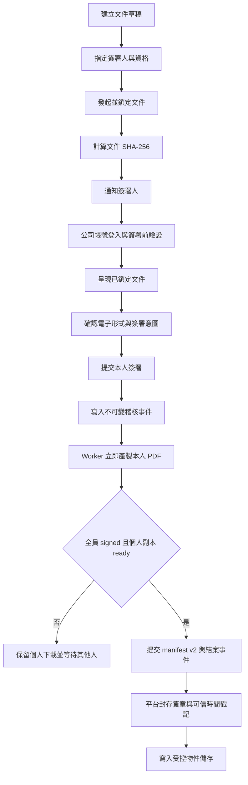
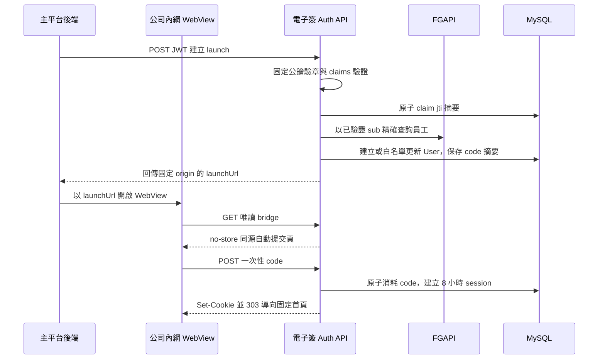

# 公司內部一般電子簽章平台技術設計建議

> 文件狀態：規劃中
> 適用範圍：饗賓內部員工，以及以 Email 受邀簽署之面試錄取人員等外部對象
> 最後更新：2026-10-12

## 1. 目的

本文件定義公司內部一般電子簽章平台的法律定位、技術要求、證據保存方式、安全控制與分階段實作方向，作為後端 API、資料庫、檔案儲存、背景工作及前端簽署流程的共同依據。

> 目前 Spec 2 已完成 WebView JWT launch、FGAPI 員工查驗與 MySQL 本地 session；文件與簽署業務 API、簽署前重新驗證及跨列狀態機仍未實作。

本系統預計採用下列方式建立電子簽署證據鏈：

- 公司帳號與員工資料辨識簽署人。
- 簽署前重新驗證或多因素驗證。
- 將簽署行為綁定到發起後不可變的特定文件及 SHA-256 摘要。
- 保存明確的簽署意圖與電子形式告知紀錄。
- 使用不可任意修改的稽核事件保存完整歷程。
- 封存最終 PDF、稽核紀錄及驗證資訊。
- 視風險使用平台憑證與可信時間戳記強化文件完整性。

本文件是產品及工程設計建議，不構成特定文件或個案的法律意見。勞動契約、個資同意書、薪資、離職或其他法定書面，仍應由法務或主管單位逐類確認適用規範與保存期限。

## 2. 法律與產品定位

### 2.1 目標定位

本系統的第一階段目標是建立符合《電子簽章法》定義、可提出完整證據鏈的「一般電子簽章平台」，簽署人包含公司內部員工及以 Email 受邀、尚未具員工身分的面試錄取人員等外部對象。

依《電子簽章法》第 2 條，電子簽章應能達成：

1. 簽章依附於電子文件並與文件相關聯。
2. 辨識及確認簽署人的身分與資格。
3. 確認電子文件真偽，並能發現簽署後的內容變更。

法律採技術中立原則，並未要求一般電子簽章一定使用特定廠商、憑證或演算法。但只有手寫簽名圖片、輸入姓名或勾選同意，而沒有身分驗證、文件綁定與防竄改證據，不能作為本系統的完整電子簽章機制。

### 2.2 非目標

第一階段不包含：

- 自行成為憑證機構（CA）。
- 自行簽發具《電子簽章法》第 6 條推定效力的個人數位憑證。
- 宣稱每位員工已使用個人私密金鑰完成數位簽章。
- 宣稱平台封存憑證等同於每位員工親自使用數位憑證簽署。
- 未經逐項法規確認，就假設所有公司文件皆可完全取代紙本。

### 2.3 一般電子簽章與數位簽章的邊界

一般電子簽章的法律效果需依個案證據判斷。本系統應以完整、可驗證的證據鏈證明簽署人、簽署意圖、實際簽署文件及文件完整性。

若未來需要《電子簽章法》第 6 條所定「推定為本人親自簽名或蓋章」的較強效果，應讓每位簽署人使用主管機關許可之憑證機構所簽發、仍在有效期間及使用範圍內的憑證完成數位簽章。屆時可保留自建平台及流程，但簽署步驟需串接合格憑證或遠端簽署服務。

平台以公司或系統憑證簽署最終文件，只能用來加強證明平台封存後的文件完整性，不代表每位員工都完成法定數位簽章。

## 3. 電子簽署成立條件

### 3.1 簽署人身分與資格

內部員工應優先使用公司既有身分系統：

- 公司 SSO、OIDC 或 Active Directory 帳號。
- 帳號與 HR 員工編號的唯一對應。
- 員工在職狀態。
- 簽署當下的部門、職稱與簽署資格快照。
- 簽署前重新驗證、MFA、OTP 或 WebAuthn。
- 驗證成功時間及不可重複使用的 authentication event ID。

帳號登入只是身分驗證手段，不應單獨視為電子簽章。身分驗證結果必須與特定不可變文件、明確的簽署操作及稽核事件綁定。

Email 外部簽署人不建立為公司員工，也不得僅以 client 傳入的姓名或 Email 認定身分。外部簽署人的邀請、Email 控制權驗證、連結或驗證碼期限、重放防護及簽署前驗證必須由後續功能規格定義，並與特定文件及簽署人指派綁定。Stage 1 不支援以手機號碼加入之外部簽署人。

系統不得保存密碼、OTP 明碼、access token、refresh token 或 session cookie。僅保存驗證方式、驗證結果、事件識別碼及必要的安全中繼資料。

#### 3.1.1 員工主檔與系統帳號合併

本系統以公司內網 WebView 形式提供，所有可透過內網或 SSO 登入完整電子簽系統的使用者都必須是公司員工，不另外維護獨立的本地使用者主檔。因此正式資料模型應將原規劃的 `auth_users` 與 `hr_users` 合併為單一 `users` 表，並以 `users.id` 作為本系統 principal ID。Email 外部簽署人僅能存取被指派的文件與必要簽署流程，不視為可登入完整系統的本地使用者。

`users` 至少應包含：

```text
id
empid
name
person_status
is_active
department_id
department_name
title_name
last_login_at
created_at
updated_at
deleted_at
```

其中 `empid` 為公司員工編號並具唯一約束。`is_active` 同時代表員工在職及可登入本系統，不另外建立語意重複的帳號啟用欄位。當 `is_active = false` 時，server 必須拒絕建立新 session，並撤銷該員工既有 session；員工資料仍須保留，以維持歷史文件、簽署及稽核紀錄的關聯。

姓名、在職狀態、部門及職稱等欄位由公司身分／HR 來源維護。同步時必須採欄位白名單更新，不得以外部 profile 整列覆蓋本地流程狀態或歷史快照。本系統 Stage 1 不建立 role、permission 或本地員工管理備註。

文件建立人、管理操作人與本地 session 均使用 `users.id`。主平台簽發的第一版 WebView JWT 以必填 `sub` 作為唯一使用者識別，其值直接為公司員工編號 `empid`，不另放重複的 `empid` claim；Server 驗證 JWT 與 FGAPI 後，再將 `sub` 對應為 `users.empid` 及 `users.id`。內部簽署人的 `esign_signers.user_id` 亦應連結 `users.id`，但簽署紀錄仍須保存員編、姓名、部門與職稱快照，避免人員資料異動後改變歷史證據。

#### 3.1.2 第一階段單一 issuer 身分對應

第一階段只串接一個公司內網 issuer，不建立 `user_auth_identities` 或 `auth_identity_providers` 資料表。Server 完整驗證 token 後，直接以 token 內受信任且必填的 `sub` 作為員工編號，對應 `users.empid`；不得使用其他 claim、姓名、Email 或部門推測身分。

受信任 provider 的 protocol、issuer、audience、允許演算法及 JWKS／introspection 位置應由 server 的受控設定管理；第一版的員工編號 claim 固定為 `sub`，不提供動態 mapping。不得依未驗證 token 或一般資料庫內容動態信任 issuer，也不得向任意 `iss` 執行 discovery。client secret、驗證私密資料及 introspection credential 必須存放於 secret manager 或等效受控環境，不得存入一般業務資料表。

此簡化方案的前提是員工編號在公司內唯一、不可任意變更，且不會重新配發給另一人。未來正式增加第二個 issuer 時，應先新增外部身分綁定資料模型，再開放新 provider，不得直接把不同 issuer 的 `subject` 塞入 `users` 單一欄位。

### 3.2 文件綁定與發起後鎖定

第一階段將每筆電子簽文件視為一次獨立且不可變的簽署流程，不建立同一文件下的 v1、v2、v3 或 `esign_document_versions`。文件在 `draft` 階段可修改；由 `draft` 進入 `in_progress` 時，server 必須在同一交易中驗證並固定原始 PDF、文件標題、簽署人、簽署欄位、簽署期間、簽署選項、適用條款版本及 canonical signing payload，並對實際持久化內容計算 SHA-256。

每次簽署前，必須驗證實際呈現的文件與發起時固定的摘要一致。簽署紀錄至少應包含：

```text
document_id
document_sha256
signer_id
consent_version
authentication_event_id
signed_at
```

文件進入 `in_progress` 後，不得修改或覆寫內容、簽署人、簽署欄位或其他已固定的 signing payload。若發起後發現錯誤，建立人應停止原流程並建立一份具有新文件編號與新摘要的獨立文件，所有簽署人重新完成簽署；既有簽署結果不得沿用，原文件、簽署結果與稽核紀錄亦不得刪除或改寫。第一階段不建立新舊文件間的版本關聯。

### 3.3 明確的簽署意圖

簽署畫面必須清楚說明行為效果，並使用明確的操作文字，例如：

> 我已完整閱讀文件內容，確認以電子方式簽署本文件，並同意本次簽署作為我的意思表示。

系統應保存：

- 簽署提示文案與版本。
- 電子簽署條款與版本。
- 文件名稱、文件編號及 SHA-256。
- 同意或拒絕結果。
- 簽署操作及時間。
- 當次身分驗證方式與結果。

不得以「下一步」、「完成」等語意不明的按鈕直接完成簽署；應使用「確認簽署」、「拒絕簽署」等明確文字。

### 3.4 電子形式告知及反對

對有相對人的文件，採用電子形式前應：

- 告知將使用電子文件及電子簽章。
- 提供反對電子形式的方式。
- 告知未反對者將推定同意採用電子形式。
- 提供日後停止採用電子形式的方式。

依《電子簽章法施行細則》第 8 條，合理期間原則上自告知日起不得少於三日，但當事人另有約定或交易上另有習慣者不在此限。內部員工是否可透過勞動契約、工作規則或系統使用條款另行約定，應交由 HR 與法務確認。

系統至少應保存告知內容、版本、告知時間、回應結果、回應時間及適用文件範圍。

## 4. 建議系統流程



### 4.1 WebView SSO 與本地 session

主平台後端以私鑰簽發最長 2 分鐘、一次性的 RS256 JWT，並經 HTTPS POST 傳至電子簽：

```http
POST /api/auth/webview-launches
Authorization: Bearer <launch-jwt>
```

JWT 只允許出現在此 Authorization header，不得放入 URL、cookie 或 request body。電子簽固定驗證 RS256、`typ`、issuer、單一 audience、`sub`、UUID v4 `jti`、`iat`、`nbf` 與 `exp`，以 MySQL unique 摘要原子 claim `jti` 後，再用 `sub` 的完整員編向 FGAPI 查驗唯一合格員工。驗證成功回傳最長 60 秒的一次性 `launchUrl`；URL 內的 code 不含身分資料。

後端流程如下：



WebView 對 `launchUrl` 的 GET 只回傳同源 form bridge，不查詢、消耗或修改 DB。頁面自動將 code POST 至 `/api/auth/session`，並保留 JavaScript 無法執行時的手動按鈕；只有 POST 才原子消耗 code、設定 `FT_ESIGN_SESSION` HttpOnly cookie 並以 `303` 導向固定首頁 `/`。GET query 與 POST body 不得寫入 access log，兩個回應均使用 `Cache-Control: no-store` 與 `Referrer-Policy: no-referrer`。

MySQL `auth_sessions` 是 `jti` 防重放、launch code 與本地 session 的唯一權威來源；資料庫只保存三種 credential 的 SHA-256 摘要。Redis 不可用不得影響 launch 建立、code 消耗、session 驗證或登出。MySQL 不可用時則安全失敗，不發 code 或 cookie。

本地 session 使用獨立的 256-bit opaque token，固定最長 8 小時且不滑動延長。受保護請求只以 cookie token 摘要查詢有效 MySQL session，再確認 User 仍存在、未 soft-delete 且 `is_active = true`；不接受 client 另行宣告員編。`DELETE /api/auth/session` 原子撤銷 MySQL session 並清除 cookie，重複登出保持冪等。

SSO 建立 session 只代表使用者可進入電子簽系統，不當然等於完成簽署前重新驗證。除非該次憑證足夠新、具可驗證的 `auth_time`／`acr`／`amr`、為短效一次性，且已綁定特定文件與摘要，否則簽署時仍須另外建立第 3.1 節所述的驗證事件。

## 5. 文件完整性與防竄改

### 5.1 摘要值

至少保存下列摘要：

```text
original_file_sha256
document_sha256
signing_input_sha256
signed_file_sha256
final_file_sha256
audit_trail_sha256
manifest_sha256
```

所有 hash 應在 server 端針對實際持久化的位元內容計算，不可信任 client 傳入的 hash。

### 5.2 不可變文件

- 已發起的文件不可原地覆寫。
- 已發起或已有簽署紀錄的文件不可更換內容、簽署人、欄位或附件。
- 發起後發現錯誤時停止原流程，另建獨立文件並重新進行完整簽署流程；不沿用既有簽署。
- 完成文件應使用物件版本控制、WORM 或 object lock 等機制防止覆寫。
- 資料庫中的 object key、hash、版本與物件儲存內容應定期核對。

### 5.3 稽核事件鏈

稽核紀錄應採 append-only 設計，不允許一般管理後台修改或刪除歷史事件。可使用 hash chain 強化竄改偵測：

```text
event_hash = SHA256(
  previous_event_hash
  + document_sha256
  + signer_id
  + event_type
  + occurred_at
  + canonical_event_payload
)
```

若資料庫使用 soft delete，稽核事件本身仍不應開放一般刪除功能。資料保存期限屆滿時，應透過經核准且可稽核的封存／銷毀流程處理。

## 6. 稽核事件

建議至少支援下列事件：

```text
document_created
document_initiated
signer_assigned
signer_notified
document_opened
identity_verified
electronic_form_notice_shown
electronic_form_accepted
electronic_form_rejected
consent_accepted
signature_submitted
signature_completed
signature_rejected
document_finalized
document_downloaded
verification_failed
```

每筆事件建議包含：

```text
event_id
document_id
signer_id
actor_type
event_type
occurred_at
authentication_method
authentication_event_id
source_ip
user_agent
document_sha256
previous_event_hash
event_hash
request_id
metadata_json
```

IP 與 user agent 僅能作為輔助證據，不應單獨用來確認簽署人身分。`metadata_json` 必須有明確 schema 與允許欄位，不可直接寫入整個 request、token、cookie、簽名圖片或文件內容。

## 7. PDF 與封存格式

### 7.1 PDF 簽章格式

本系統以 PDF 為主要完成文件格式時，建議依 ETSI PAdES 規格設計。若需要多年後仍可驗證簽章，應評估 PAdES-LT 或 PAdES-LTA，並保存憑證鏈、撤銷狀態及可信時間戳記。

簽名圖片是視覺呈現的一部分，不是密碼學簽章本身。最終 PDF 應同時保留可供人閱讀的簽署資訊及可由程式驗證的完整性資料。

### 7.2 可信時間戳記

若採用時間戳記服務，建議使用 RFC 3161 相容 TSA。時間戳記應針對文件或證據包摘要產生，並保存：

- timestamp request／response。
- TSA 憑證鏈。
- 使用的 hash algorithm 與 OID。
- 驗證結果及驗證時間。

只有 server 本機時間不足以作為高可信度時間證據。所有服務仍應使用可靠的 UTC 時間來源及時間同步監控。

### 7.3 證據包

每份完成文件應可匯出為獨立驗證的證據包：

```text
documents/{document_uuid}/
├── original/
│   └── source.pdf
├── final/
│   └── completed.pdf
└── evidence/
    ├── manifest.json
    ├── audit-trail.json
    ├── audit-trail.pdf
    ├── certificates.pem
    ├── revocation-data.bin
    └── timestamp-response.tsr
```

`manifest.json` 建議包含：

```json
{
  "documentId": "文件 UUID",
  "originalHash": "SHA-256",
  "finalHash": "SHA-256",
  "auditTrailHash": "SHA-256",
  "signaturePolicyVersion": "1.0",
  "completedAt": "UTC timestamp",
  "signers": [
    {
      "signerId": "不可變識別碼",
      "signedDocumentHash": "SHA-256",
      "authenticationMethod": "SSO_MFA",
      "signedAt": "UTC timestamp"
    }
  ]
}
```

產生 manifest 時需使用固定 canonicalization 規則，避免 JSON 欄位順序或序列化差異造成不同 hash。

## 8. 檔案儲存

正式文件不應放在 `client/public`、應用程式容器映像或 MySQL BLOB。應存放於 private object storage，例如公司內部 S3、MinIO 或具備等效控管的儲存服務。

### 8.1 Spec 03 已實作的 runtime 邊界

Spec 03 以 `PrivateFileStorage` 作為唯一檔案邊界。local 與 automated test 使用不對外公開的本機目錄；UAT 使用 HTTP server 與 worker 共用、跨重啟保留的 private persistent volume；production 固定使用啟用 Block Public Access 的 private S3。S3 認證只使用 runtime IAM role／AWS SDK default credential chain，不新增 access key 環境變數。任何必要 driver、bucket、region、volume 或權限缺失均在啟動或操作時 fail closed，production 不得 fallback 至 local。API 不回傳 bucket URL 或 presigned URL，所有 PDF 仍須經 resource-level authorization 後由 server 串流。

外部邀請郵件使用 `InvitationMailSender`：local 經 SMTP 投遞 Mailpit、automated test 使用 in-memory fake、UAT 使用 SES sandbox、production 使用已移出 sandbox 的 SES。UAT 的 sender 與測試收件人須在相同 region 完成驗證；production 使用已驗證 sender/domain。郵件只包含文件名稱、建立人、台北截止時間及 opaque invitation URL，不附 PDF、不列出其他簽署人，也不提供催簽或完成通知。

HTTP process 只註冊 BullMQ producer；獨立 worker 才載入 invitation、finalization 與 maintenance processors。MySQL transaction 與 constraint 是業務權威，Redis/BullMQ 只負責喚醒、重試與每 30 秒 reconciliation。Queue payload 只放 `notificationLogId` 或 `documentId`，不得包含 Email、token、PDF、PNG 或 cookie；Redis 暫時不可用不回滾已成立的 MySQL 簽署結果，恢復後由 maintenance 依 DB 現況收斂。

相關設定與 migration：

- migration：`1791936000000-CoreEsignFlow.ts`，可 run/revert/run；entity、migration 與 `schema.sql` 同步維護。
- storage：`ESIGN_STORAGE_DRIVER`、`ESIGN_STORAGE_ROOT`、`ESIGN_S3_BUCKET`、`AWS_REGION`。
- mail：`ESIGN_MAIL_DRIVER`、`SMTP_*`、`SES_FROM`。
- external access：`EXTERNAL_SIGNING_ORIGIN`、`ESIGN_INVITATION_ENCRYPTION_KEY_B64`。
- queue：沿用 `REDIS_HOST`、`REDIS_PORT`、`REDIS_PASSWORD`、`REDIS_DB`，不新增第二套 Redis 設定。

Spec 03 的正式範圍只含建立/發起、內外部簽署、完成 PDF、自動結案、手動停止與到期停止。不含拒簽/退回、補簽、催簽、完成通知、一般匯出、QR 公開驗證、文件版本、證據包、PAdES-LT/LTA 或長期封存；repository 內保留的原型檔案或預留 schema 不代表這些功能已正式開放。

資料庫僅保存：

- object key。
- 檔案版本。
- MIME type 與檔案大小。
- SHA-256。
- 加密及封存狀態。
- 建立與完成時間。

不得將永久公開 URL 存入資料庫。下載時必須先由 server 驗證文件權限，再使用短效 signed URL 或由 server 串流內容。

必要控制包含：

- TLS 傳輸加密。
- 靜態加密。
- Private bucket。
- Object versioning／object lock。
- 備份、還原演練及災難復原。
- 跨環境 bucket 與金鑰隔離。
- 檔案下載與驗證稽核。
- 依文件類型設定保存期限及合法銷毀流程。

## 9. 金鑰與密碼學

第一階段建議：

- 文件摘要使用 SHA-256 或經安全審查核准的更新演算法。
- 平台私鑰存放於 HSM、雲端 KMS 或受控的簽章服務。
- 私鑰不得存放於資料庫、Git、應用程式檔案或一般環境變數。
- 金鑰操作應有最小權限、輪替、撤銷及稽核機制。
- 驗證憑證有效期、用途、完整憑證鏈與 OCSP／CRL 狀態。
- 不自行設計加密演算法或簽章格式。

若未來串接個人數位憑證，應確保實際簽署使用的是簽署人的私密金鑰，並符合憑證機構的使用範圍與驗證流程。

## 10. 個資與安全控制

文件內容、員工資料、手寫簽名、IP、裝置資訊及稽核紀錄可能構成個人資料。系統應落實：

- 蒐集目的及必要欄位最小化。
- 告知資料類別、利用期間、地區、對象與方式。
- 由 server 依文件建立人、指定簽署人、文件狀態與操作目的逐項驗證資源授權，不依賴通用 RBAC。
- 建立人、簽署人、管理者、稽核人員與維運人員職責分離。
- 敏感欄位遮罩及最小揭露。
- 日誌不記錄文件全文、簽名圖片、cookie、token 或 OTP。
- 對大量下載、異常驗證、權限變更及管理操作發出告警。
- 定期弱點掃描、滲透測試與權限檢查。
- 供應商、備份與外部儲存的委外管理。
- 個資事件通報及應變流程。

若蒐集簽名速度、壓力、筆跡軌跡等動態特徵，將增加身分特徵與隱私風險。除非身分驗證需求明確且完成個資影響評估，第一階段不建議蒐集。

## 11. 建議後端模組

```text
server/src/features/esign/
├── documents/        # 文件草稿、發起鎖定與狀態
├── signers/          # 簽署人、資格與簽署狀態
├── signing/          # 簽署指令、同意與拒絕
├── audit/            # append-only 稽核事件
├── evidence/         # manifest 與稽核報告
├── verification/     # hash、憑證與證據驗證
└── exports/          # 受控下載與匯出

server/src/infrastructure/
├── object-storage/   # S3／MinIO adapter
├── signing/          # HSM／KMS／平台簽章 adapter
└── timestamp/        # RFC 3161 TSA adapter
```

Controller 只處理 HTTP 邊界；文件狀態、簽署資格、發起後鎖定與完成條件應由 domain/service 層驗證。最終 PDF、證據包、通知、hash 對帳與時間戳記適合交由 worker 執行。

## 12. 資料模型補充方向

現有 schema 可作為業務草稿，但正式實作前至少需要補足下列概念：

- `users`：合併員工主檔與本系統 principal、在職及登入狀態；取代獨立的 `auth_users` 與 `hr_users`，不包含通用角色或 permission。
- `esign_documents`：每筆代表一次獨立且不可變的簽署流程；第一階段不另建文件版本表。
- `esign_signing_consents`：電子形式告知及簽署意圖版本。
- `esign_identity_verifications`：簽署前身分驗證結果。
- `esign_audit_events`：不可變稽核事件及 hash chain。
- `esign_evidence_packages`：最終文件、manifest、稽核報告與時間戳記。
- `esign_file_objects`：object key、hash、版本、大小及封存狀態。

是否新增或調整資料表，需在功能規格確認後，以 TypeORM entity、migration、測試與 `schema.sql` 同步實作；本文件本身不授權直接建立 migration。

## 13. Spec 實作路線圖

以下順序描述預定功能邊界；每一份 Spec 仍須在進入實作前完成 specify、clarify、plan 與 tasks。後續 Spec 不得回頭放寬第 3.2 節的不可變文件規則。

### Spec 2：WebView SSO 與正式身分驗證

- 由主平台私鑰簽發、電子簽以預先信任公鑰驗章的短效一次性 WebView JWT；第一版固定單一 issuer、audience、用途與 RS256 演算法。
- WebView 以 HTTPS POST authorization header 提交 JWT，不使用 URL query；以必填 `sub` 作為唯一使用者識別，其值即為 `empid`，不另放重複的 `empid` claim，並驗證其餘必要 claims、2 分鐘有效期與一次性 `jti`，防止竄改、錯用與重放。
- 以已驗證員工編號查詢 FGAPI，只有唯一精確且具第一版登入資格的員工可建立或白名單更新本地 `User`。
- 建立最長 8 小時的電子簽本地 session，支援到期與主動登出；不得保存或重用上游原始 JWT。
- 提供後續建立文件、資源授權與內部員工簽署可共同使用的可信員工 principal。
- 定義測試與非正式環境如何安全建立 session，使後續功能能執行真實 guard、權限與 HTTP 驗證，不以 client 傳入的員工識別冒充身分。
- 對過期、重放、錯誤 issuer／audience／claim、FGAPI 查無精確員工及跨 session 冒用採安全失敗與去敏感稽核。

Spec 2 先處理內部員工 WebView 入口與通用 session，不處理離職後的事件通知、定期同步、立即停用或既有 session 主動撤銷。Email 外部簽署人的單一文件受限 session，以及綁定文件與摘要的簽署前驗證，隨實際簽署流程於 Spec 3 定義；兩者不得偽裝成完整員工 session。

### Spec 3：核心電子簽端到端流程

目標是在 Spec 2 的可信員工身分與 session 基礎上，完成一條簡單、可驗收的完整流程：建立文件、指定簽署人、發起並鎖定、簽署、產生完成 PDF、自動結案。

- 建立、編輯及刪除尚未發起的 PDF 草稿。
- 指定內部員工簽署人，或以姓名與正規化 Email 建立外部簽署人；外部簽署人不建立 `User`。
- 在 PDF 上設定第一階段支援的簽名與日期欄位。
- 發起時由 server 驗證必要資料、固定 canonical signing payload、計算實際持久化 PDF 的 SHA-256，並將文件切換為 `in_progress`。
- `in_progress` 後鎖定 PDF、文件標題、簽署人、簽署欄位、簽署期間、簽署選項及適用條款版本。
- 內部簽署人及具單一文件受限存取權的 Email 簽署人可閱讀文件、表達明確簽署意圖並完成簽署；Email 控制權必須經 server 驗證，不得只相信 client 宣告。
- Email 外部簽署採獨立、限時且只綁定 signer／document 的 session；內部員工則使用 Spec 2 建立的正式員工 session。
- 每次成功簽署保存文件摘要、簽署人快照、同意版本、驗證事件、簽署時間及最小必要 append-only 稽核事件。
- 每人簽完即產製本人 PDF；全員 signed 且每份副本 ready 後，以獨立交易保存 manifest v2 並將文件切換為 `completed`。
- 發起後發現錯誤時，只能停止原流程並建立新文件；不提供原地修改、文件版本、簽署沿用或新舊文件版本關聯。
- 提供建立人與簽署人完成上述流程所需的最小列表、詳情及受控檔案存取。

Spec 3 只涵蓋成功簽署主路徑及 Email 邀請所需的最小通知，不包含拒絕／退回、依序簽署、批次催簽、匯出、公開驗證、長期封存或數位憑證。

### Spec 4：簽署前重新驗證

- 依文件風險定義內部員工簽署前的重新驗證要求，不將一般登入直接視為完成簽署驗證。
- 將驗證結果綁定特定簽署人、文件、文件摘要與短效一次性 authentication event。
- 定義可接受的驗證新鮮度、驗證強度與過期條件。
- 防止驗證事件跨文件、跨簽署人或重複使用，並保存必要且最小化的驗證證據。

### Spec 5：簽署例外與通知營運

- 允許文件依設定接受拒絕簽署，保存拒絕原因與終止狀態，不建立成功簽署紀錄。
- 簽署開始／截止時間、逾期處理，以及文件停止後禁止繼續簽署。
- 通知全部或僅待簽者、重新通知、每次通知批次與逐一發送結果。
- 明確定義平行簽署；若未來需要依序簽署，必須另立需求，不預先實作。
- 補強並發提交、重複操作及 worker 重試的一致性。

### Spec 6：證據包、下載、匯出與公開驗證

- 產生 canonical manifest、完整 audit trail 及人類可讀稽核報告。
- 建立不可預測的公開驗證 ID 與 QR Code，重新驗證最終 PDF hash、manifest hash 及 audit chain。
- 公開驗證只揭露最小必要資訊，不公開文件內容、完整員編、簽名圖片或未遮罩個資。
- 受權限控管的完成 PDF 下載、下載稽核及選配浮水印。
- 單一文件 PDF 與簽署紀錄清單匯出、背景工作狀態、匯出歷史及受控下載。
- 驗證紀錄撤銷或取代時保留原紀錄並追加稽核事件。

### Spec 7：強化封存與長期驗證

- 平台憑證封存簽章。
- RFC 3161 可信時間戳記。
- PAdES-LT／LTA 評估與實作。
- 憑證鏈、OCSP／CRL 與撤銷資料保存。
- Object lock、備份、復原演練、保存期限及合法銷毀流程。
- 第三方資安、個資與長期驗證稽核。

### Spec 8：高風險文件數位簽章

- 盤點需要《電子簽章法》第 6 條推定效果的文件類型。
- 串接主管機關許可的憑證機構或遠端簽署服務。
- 讓簽署人以自己的私密金鑰完成簽章。
- 建立憑證生命週期及失效／撤銷處理。
- 評估申請電子簽章解決方案服務能量登錄。

## 14. 上線驗收清單

### 法律與流程

- [ ] 已逐類確認文件是否可使用電子形式。
- [ ] 已由 HR／法務確認電子形式告知與反對流程。
- [ ] 簽署按鈕及同意文案能清楚表達簽署意圖。
- [ ] 條款、告知與簽署政策皆有版本。
- [ ] 產品文案未把一般電子簽章誤稱為第 6 條數位簽章。

### 身分與授權

- [ ] 帳號可唯一對應員工。
- [ ] `auth_users` 與 `hr_users` 已合併為單一員工 principal，沒有重複身分主檔。
- [ ] 已驗證 token 必須以 `sub` 承載唯一員工編號，並只以該值對應 `users.empid`。
- [ ] 受信任 provider 由 server 設定白名單管理，不依 token 內容動態信任 issuer。
- [ ] SSO token 不經 URL query 傳遞，原始 token 不進入 DB、session 或 log。
- [ ] 本地 session 不晚於上游憑證／session 到期，員工停用時會撤銷既有 session。
- [ ] 簽署前執行符合風險的重新驗證。
- [ ] Server 端重新檢查在職、簽署資格、期限與文件狀態。
- [ ] 管理者無法冒用簽署人完成簽署。
- [ ] 文件建立、簽署、稽核與維運權限已適當分離。

### 文件與證據

- [ ] 每次簽署固定綁定特定不可變文件與 SHA-256。
- [ ] 已發起及已簽文件不可覆寫；修正時以新文件重新發起且不沿用簽署。
- [ ] 稽核紀錄為 append-only 並可偵測變更。
- [ ] 可匯出最終 PDF、manifest 及完整 audit trail。
- [ ] 能離線或透過獨立流程重新驗證證據包。
- [ ] 所有 DB 時間以 UTC 保存。

### 儲存與安全

- [ ] 文件存放在 private object storage。
- [ ] 下載前由 server 驗證權限。
- [ ] 檔案、簽名、cookie、token 與 OTP 不會進入 log。
- [ ] 金鑰存放於 HSM、KMS 或受控簽章服務。
- [ ] 已完成備份、復原及封存完整性演練。
- [ ] 已定義保存期限及合法銷毀流程。
- [ ] 已完成個資、資安及法務驗收。

## 15. 官方參考資料

- [電子簽章法](https://law.moj.gov.tw/LawClass/LawAll.aspx?PCode=J0080037)
- [電子簽章法施行細則](https://law.moj.gov.tw/LawClass/LawAll.aspx?pcode=J0080039)
- [電子簽章法釋疑與應用參考指引](https://www-api.moda.gov.tw/File/Get/adi/zh-tw/aLjl1a2m8B27AF4)
- [何種電子簽章技術具電子簽章效力（產經字第 1114000229 號）](https://www-api.moda.gov.tw/File/Get/moda/zh-tw/IECWFhsBwSg9XTt)
- [數位產業署：電子簽章解決方案服務能量登錄](https://ipfs.moda.gov.tw/ADI/services/apply-serivces/energy/9345.html)
- [電子簽章解決方案服務能量登錄申請計畫書](https://www-api.moda.gov.tw/File/Get/adi/zh-tw/ngm9CXR1fESAjqw)
- [ETSI PAdES](https://portal.etsi.org/webapp/WorkProgram/Report_WorkItem.asp?WKI_ID=47085)
- [RFC 3161 Time-Stamp Protocol](https://www.rfc-editor.org/info/rfc3161/)
- [NIST FIPS 186-5 Digital Signature Standard](https://csrc.nist.gov/pubs/fips/186-5/final)
- [個人資料保護法](https://law.moj.gov.tw/LawClass/LawAll.aspx?PCode=I0050021)

## 共用欄位、個人副本與規模邊界（2026-10-16）

上傳時只保存共用 signature／date 位置，不指定簽署人；發起時指定完整名單、期間與選項並固定 payload。每份文件最多 200 個共用欄位，不乘簽署人數。簽署人數沒有固定上限；6,000／6,001 人是驗收樣本，傳輸大小與處理時間仍受部署資源限制。

個人完成 PDF 以 esign_file_objects.signature_record_id 擁有，經 record → signer 回到同一 document。10 人會形成 10 份本人副本，不新增 10 份文件流程。完成檔亦允許 document owner，兩種 owner 必須互斥；未來簽到表的多筆參與證據放在 manifest，本次不實作該流程。

簽署後即排工作，5 分鐘 lease 位於 signer。只有等待中的 queue 工作做技術性合併，worker 開始時釋放該合併鍵；DB claim、fencing token、唯一約束與 ready 狀態仍是唯一業務權威。既有 30 秒 maintenance 掃描完整候選，失效 queue 可由 DB 狀態補回。

建立人可下載任一 ready 副本，內部員工只能下載本人副本。停止不刪已簽證據，既有 signed 副本繼續產製，stopped 不再結案。外部邀請簽完即失效，移除 receipt，完成 PDF 由建立人提供。

新 snapshot 使用 manifest v2，保存各 record/file/hash/copy event；final_pdf_sha256 為 NULL。公開驗證僅 completed 回本人的檔案摘要，其餘狀態為 NULL。migration 僅轉換舊單人完成檔 owner metadata，不更動 bytes/hash/payload；部署及回滾依 specs/003-core-esign-flow/quickstart.md。
